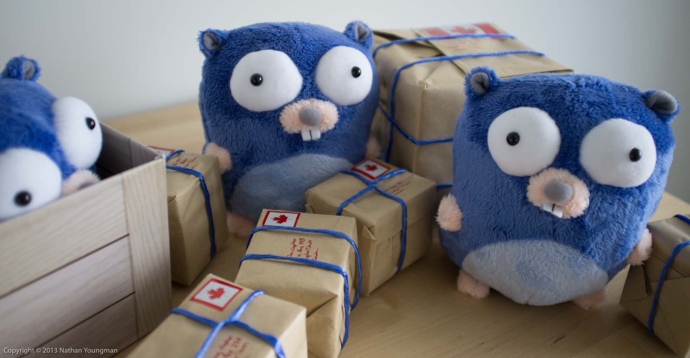

*Go get* is [cool and all](http://www.goinggo.net/2013/08/organizing-code-to-support-go-get.html), though some assembly is required. How does your team handle reproducible builds? How will we version packages to handle bug reports?

Hailing from the Ruby community, my tendency has been to gravitate towards a [SAT solver](http://en.wikipedia.org/wiki/Boolean_satisfiability_problem) for dependency management. Given that it took 13 months for [Bundler](http://bundler.io/) 1.0 to be realized, I don't expect this to happen overnight, and I personally have no idea how to write one. If you're in the same boat, you may be wondering how to help out.

There a few simple things <mark>we can all do</mark> to improve the Go ecosystem. Before you unleash your next open source project and \[ANN\] it on [Go Nuts](https://groups.google.com/forum/#!forum/golang-nuts), consider this.

## See What's Out There

Before getting started, do a search on [GoDoc](http://godoc.org/) or ask around.

Here are a few packages for working with databases:
[codex](https://github.com/chuckpreslar/codex),
[gorp](https://github.com/coopernurse/gorp),
[goSQL](https://github.com/quintans/goSQL),
[hood](https://github.com/eaigner/hood),
[jet](https://github.com/eaigner/jet),
[kdb](https://github.com/sdming/kdb),
[meddler](https://github.com/russross/meddler),
[sqlx](https://github.com/jmoiron/sqlx),
and
[Vivom](https://github.com/oguzbilgic/vivom).

We probably have enough options, but I bet any one of these packages could be improved upon. Why not find something close to your needs and contribute?

If later you decide to start fresh, or take a wildly different approach, you'll have met a fellow gopher, and probably learned something too.

## Write A Readme

Make a good first impression with a README that describes the purpose of your project, how to install it, and how to use it.

You might even consider [writing it first](http://tom.preston-werner.com/2010/08/23/readme-driven-development.html). Go itself began with the spec:

```bash
$ hg log -r4
changeset:   4:4e9a5b095532
user:        Robert Griesemer <gri@golang.org>
date:        Sun Mar 02 20:47:34 2008 -0800
summary:     Go spec starting point.
```

If you're writing a package, be sure to [document the APIs](http://golang.org/doc/articles/godoc_documenting_go_code.html) and link to your [GoDoc](http://godoc.org/) page from the README.

### Contributing

In addition to a `README.md`, provide instructions for those who have a question, an issue, or code to contribute. Put this in a file named `CONTRIBUTING.md`. If you're using GitHub, it will link to your CONTRIBUTING file from the *New Issue* form:

> Please review the [guidelines for contributing][contributing] to this repository.


## Choose A License

Go is under a BSD (3-clause) License. I don't need the third clause for personal projects, so I just use the BSD 2-clause License (Simplified BSD). [Choose whatever license suits your needs](http://choosealicense.com/).

There is a `LICENSE` file in the root of my Development folder with the Copyright set, so I can just copy the file and I'm good to go. I'm investigating [project generators](https://github.com/gophertown/template/issues/1) to make this process even smoother.

## Tag Your Releases

40-character SHAs aren't the best for conversation.

>What version did you have when you ran into this bug?

>Oh, I think it was commit df126e5386a3ed95a945f99cd910a2b82dc422c6.

Where versions can be compared very simply, eg. >= 3.2.0, a tool could only tell if 11586e3 > b1e3a97 with the full DVCS history.

Right now `go get` has no concept of versions, but the DVCS way to indicate versions is through tags. Tools like [Johnny Deps](https://github.com/vividcortex/johnny-deps) and [Rx](http://godoc.org/kylelemons.net/go/rx) already make use of tags to checkout specific releases. When I looked at using one of these tools, I found that 3 of 4 dependencies had no tags (sad panda). Then I realized I hadn't tagged my project yet either!

Whether or not you use these tools, it's still a good habit to add tags in your DVCS of choice.

### Git

See [Pro Git](http://git-scm.com/book/ch2-6.html) for details.

```bash
git tag v1.0.0         # Tag the current revision
git tag v0.1.0 b13a082 # Tag a past revision
git tag                # List tags
git push origin --tags # Share tags (pushes tags only)
```

### Mercurial

See [Mercurial: The Definitive Guide](http://hgbook.red-bean.com/read/managing-releases-and-branchy-development.html) for details.

```bash
hg tag v1.0.0          # Tag the current revision
hg tag -r 13 v0.1.0    # Tag a past revision
hg tags                # List tags
hg push                # Share tags (.hgtags already committed)
```

### Bazaar

See [Bazaar Wiki](http://wiki.bazaar.canonical.com/Tag) for details. *Yes, these instructions are exactly the same as Mercurial.*

```bash
bzr tag v1.0.0         # Tag the current revision
bzr tag -r 13 v0.1.0   # Tag a past revision
bzr tags               # List tags
bzr push               # Share tags (stores tags with branch)
```

### Versions

Go uses Semantic Versioning and ***so should you.*** Go went through **many changes** until it stabilized as 1.0.0. This year 1.1.0 was released, a backwards compatible update. 1.1.2 was a patch release, and breaking changes await a 2.0.0 release in the **distant future.** Please <mark>read and follow</mark> [Semantic Versioning 2.0.0](http://semver.org/).

That said, all my work is 0.y.z. I may avoid the v2 problem by never having a v1. :-P

> "Major version zero (0.y.z) is for initial development. Anything may change at any time. The public API should not be considered stable." - SemVer

If you have something against versions, please still tag your releases. Might I suggest using the international date format (ISO 8601), as in <mark>r2013-08-31</mark>?

***Add a tag today!***

### Futureproof

Before we can even consider specifying dependencies, we need to version our releases. Using a consistent format opens up possibilities for future tooling, but tags remain useful for humans, even if tools don't use them directly.

In case you are wondering, there are APIs to list tags for [GitHub](http://developer.github.com/v3/git/refs/#get-all-references) and [BitBucket](https://confluence.atlassian.com/display/BITBUCKET/repository+Resource#repositoryResource-GETalistofthetags).


## Write a Changelog

[Dominik Honnef](http://dominik.honnef.co/) is writing a wonderful series entitled *"What's happening in Go tip"*. Reading a high-level summary of changes is so much nicer than parsing dozens of commit messages.

This is the benefit of providing a changelog for your project, even if it's just in point form. Here's an example:

```
# Changelog

## v0.2.1 / 2013-07-06

* Add --debug flag to help track down [#6] Tests run twice

## v0.2.0 / 2013-05-16

* Rename to Looper
* Packages are the unit of compilation in Go. Use a package-level
  granularity for testing.
* Don't log Stat errors (can be caused by atomic saves in editors)
...
```

Please take note:

* Entries are in ***reverse chronological*** order, putting the most relevant information first.
* The first "word" for ***second-level headings*** matches the **tag** we used previously.
* A standard file name makes it easier for humans to locate. `CHANGELOG.md` was the most favoured [in the survey][results] that accompanied this article, so I am renaming my Changelogs.
* Though not shown here, it's fairly common to have an "Unreleased" section at the top, building up a list of changes that will become the next release.

Markdown is a well known format that displays nicely on GitHub and BitBucket. There was an overwhelming preference for Markdown in the [survey results][results].

[Tools exist to generate changelogs](http://rubyworks.github.io/vclog/), though I have yet to try any. What I find more interesting are tools to [parse changelogs](https://github.com/tech-angels/vandamme). Apps like [Gemnasium](https://gemnasium.com/) will present the *relevant subset* of a changelog. Consistent use of tags, subheadings and file names make this kind of tooling fairly straightforward.

## Green Master

If you're not already using the "feature branch, [pull request](https://help.github.com/articles/using-pull-requests), code review" workflow for your own work, I highly recommend it.

In addition to writing tests, it's useful to set up <mark>Continuous Integration</mark> to run those tests against the latest dependencies. All these services offer <mark>Continuous Deployment</mark> as well. Your servers don't need Go installed, and if any dependency snafus arise, they can be identified before deployment begins.

Here are a few services that support Go and are free for open source.

### GoCI

[GoCI](http://goci.me/) is an [open source](https://github.com/zeebo/goci) continuous integration service by Jeff Wendling.

While more rudimentary than the other offerings, I'm curious what it could become if the Go community chips in.

### drone.io

[drone.io](https://drone.io/) is super quick to setup through the web interface, and it supports GitHub, BitBucket and Google Code. I'm impressed.

For those private projects, the pricing is quite competitive, and it so happens to be [written in Go](https://groups.google.com/forum/#!topic/golang-nuts/Lo7KP3rWP3o) too. The default build commands for Go [may need a little tweaking](https://gist.github.com/nathany/6402146).

### Travis CI

[Travis CI](https://travis-ci.org/) has been around longer than most, and has some nice features. Though it only integrates with GitHub, Travis will let you know if pull requests are *safe to merge.* It also allows testing against [older versions of Go or Go tip](http://about.travis-ci.org/docs/user/languages/go/).

### wercker

[wercker](http://wercker.com/) looks to be the most flexible offering, though at the same time I felt a little overwhelmed. It allows the community to build custom boxes for any language or environment required, and includes [support for Go](http://devcenter.wercker.com/articles/languages/go.html).

They [blog on Go](http://blog.wercker.com/tags/golang.html) deployment to Heroku and App Engine, code coverage, and more. Wercker is currently a free beta, but they plan to keep it [free for open source](https://hacks.mozilla.org/2013/02/wercker-continuous-delivery-made-easy-a-webfwd-project/).

## Finî

I hope this is a good starting place for practices that are beneficial to us humans today, while also paving the way for more and better tooling.

When this article was first published, I included a survey, to help establish some conventions for tagging and naming of changelogs. With only [92 respondents][results], it may not be conclusive, but I'm already updating my projects based on the results.

Hopefully some tools will appear that can rely on these conventions, and I'm currently investigating a [badge](http://b.repl.ca/) to help encourage adoption.

Let me know how I can improve this article. You can reach me on Twitter [@gophertown](https://twitter.com/gophertown) or comment on [Go+](https://plus.google.com/104313268939103200754/posts/Ca9S8UjSfLU),
[reddit](http://www.reddit.com/r/golang/comments/1lgy4p/releasing_open_source_for_humans_and_for_tooling/), or the
[Go Nuts mailing list](https://groups.google.com/forum/#!topic/golang-nuts/FyXLZNPH7_U).

Related Articles:

* [Go Package Management](/go-packages)
* [A Better Changelog](http://bitprophet.org/blog/2013/09/14/a-better-changelog/)
* [Continuous Integration for Go Code](http://jmcvetta.github.io/blog/2013/08/30/continuous-integration-for-go-code/)

[contributing]: https://github.com/gophertown/looper/blob/master/CONTRIBUTING.md
[survey]: https://docs.google.com/forms/d/1XGjy74hrq2DG-Zh4VwqxSuAWPlLf2zx5KAU1VCph5ys/viewform
[results]: https://docs.google.com/a/nathany.com/forms/d/1XGjy74hrq2DG-Zh4VwqxSuAWPlLf2zx5KAU1VCph5ys/viewanalytics
