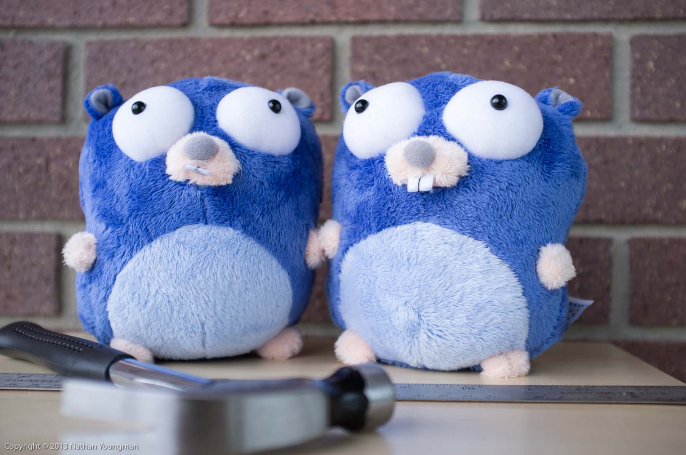

Lets explore some of the tools available for testing our Go code.

## Unit Testing

Go has testing baked in. Below we contrast the standard [testing][] package and Gustavo Niemeyer's popular [gocheck][] library:

```go
// with testing
if !reflect.DeepEqual(value, 42) {
    t.Errorf("Give us the ultimate question then")
}

// with gocheck
c.Check(value, DeepEquals, 42, Commentf("Give us the ultimate question then"))
```

Gocheck one-liners are a little more concise, and we don't lose out in extensibility. For example, gocheck [doesn't ship with a delta checker for floats](https://bugs.launchpad.net/gocheck/+bug/1131537). I wanted something that looked like this:

```go
c.Assert(gear.GearInches(), Within, 0.01, 137.1)
```

So I wrote [a custom checker](https://github.com/nathany/go-poodr/blob/master/chapter9/gear1/gear1_check_test.go) in less than 20 lines of code. Arguably, I could've written a `Within()` helper function in 3. So you win some, you lose some.

There are ways to write concise tests without pulling in an xUnit assertion frameworks. If you've ever seen Cucumber <mark>data tables</mark>, you will appreciate [table driven tests][tabledriven], a simple way of testing many variations with relatively compact code.


### Alternatives

Gocheck isn't the only third-party option out there. Andrea Fazzi's [PrettyTest][] has a colourful test runner, and it is compatible with gocheck assertions.

Go has anonymous functions, so it was only a matter of time before someone built a [Jasmine][]-style BDD library. There are several options, including [Mao][]/[Zen][] and [GoConvey][]. Unfortunately I haven't had a chance to try these yet, so I can't vouch for them. 

No doubt there are other tools that have slipped past my radar. Lately I've been reaching for the standard testing package, mostly to avoid *yet-another-dependency* in reusable libraries.


## Mocking

Mocking, stubbing, fakes, test doubles... it can be a bit confusing.

A summer ago, I was learning OpenGL, and wanted a way to stub out the graphics context in tests. I looked at [gomock][], but I wasn't a huge fan of the code generation required, and I didn't actually need expectations.

So I looked for a light weight alternative. The solution was to use <mark>interfaces</mark> in the production code, which allowed me to write a test double that satisfied said interface. That worked pretty well, and is the approach I continue to use today.

If an interface doesn't fit the problem, Karl Seguin has an different approach, by [redefining functions in tests][injection]. [Gomock][] has continued to improve and may fit your situation, and there is a newcomer to the mocking scene, [withmock][].

Then there are specialized "mocking" tools. For testing HTTP client libraries, the standard library ships with [httptest][]. Will Norris explains how it works in *[Testing in go-github](https://willnorris.com/2013/08/testing-in-go-github)*.


## Coverage

Test coverage allows you to see if there are methods or conditional branches that running your test suite doesn't reach.

Andrew Gerrand and Rob Pike developed a new coverage tool, as mentioned in the [Go 1.2 Release Notes](http://tip.golang.org/doc/go1.2#cover). After you *go get* it, a lovely HTML report in your browser is as simple as:

```bash
go test -coverprofile=c.out -covermode=count
go tool cover -html=c.out
```

If the new cover tool doesn't suit your fancy/needs, take a look at Andrew Wilkins' [gocov][]. If you are using drone.io for CI, you can hook it up to [Coveralls][]. See [goveralls](https://github.com/mattn/goveralls) for details.

Having played with both, I much prefer the new cover tools UI to [Coveralls][]. It's snappy and easy to navigate.

## Continuous Integration

If you're a fan of [Jenkins][], take a look at [go2xunit][], otherwise you may like one of these services. They all support Go and are <mark>free for open source</mark>.

### GoCI

[GoCI](http://goci.me/) is an [open source](https://github.com/zeebo/goci) continuous integration service by Jeff Wendling.

While more rudimentary than the other offerings, I'm curious what it could become if the Go community chips in.

### drone.io

[drone.io](https://drone.io/) is super quick to setup through the web interface, and it supports GitHub, BitBucket and Google Code. I'm impressed.

For those private projects, the pricing is quite competitive, and it so happens to be [written in Go](https://groups.google.com/forum/#!topic/golang-nuts/Lo7KP3rWP3o) too. The default build commands for Go [may need a little tweaking](https://gist.github.com/nathany/6402146).

### Travis CI

[Travis CI](https://travis-ci.org/) has been around longer than most, and has some nice features. Though it only integrates with GitHub, Travis will let you know if pull requests are *safe to merge.* It also allows testing against [older versions of Go or Go tip](http://about.travis-ci.org/docs/user/languages/go/).

### AppVeyor

[AppVeyor][] is a CI service for .NET developers. I approached them over Twitter to be able to test Go libraries on Windows. They added the option to build using a PowerShell script, installed Go on their servers, and have since [officially announced Go language support][appveyor-ann].

Here is the [source code][appveyortest] for a sample application with the build commands.

### wercker

[wercker](http://wercker.com/) looks to be the most flexible offering, though at the same time I felt a little overwhelmed. It allows the community to build custom boxes for any language or environment required, and includes [support for Go](http://devcenter.wercker.com/articles/languages/go.html).

They [blog frequently on Go](http://blog.wercker.com/tags/golang.html) deployment to Heroku and App Engine, code coverage, and more. Wercker is currently a free beta, but they plan to keep it [free for open source](https://hacks.mozilla.org/2013/02/wercker-continuous-delivery-made-easy-a-webfwd-project/).


## Cross-Platform Testing

### Vagrant

[Vagrant][] and [VirtualBox][]

[Vagrantfile][] in my src folder (`src/Vagrantfile`)

<mark>synced folder</mark>

vagrant up
`vagrant halt` and `vagrant destroy`

(can't run Looper inside the VM on a synced folder)

### Windows

not aware Vagrant

Windows 7 Professional license

[download Windows Virtual Machines][modernie] from Microsoft
nag a bit but they're free

sharing my project folder which contains src, bin, and pkg.

becomes Z:\project

no conflicts

`bin\*.exe`
`pkg\windows_amd64`

PowerShell

Installed Go binaries by hand.


## Autotest

Some people like running tests directly in their editor or IDE

Terminal window

Looper


Related Articles:

* [Continuous Integration for Go Code](http://jmcvetta.github.io/blog/2013/08/30/continuous-integration-for-go-code/) by Jason McVetta


[testing]: http://golang.org/pkg/testing/
[tabledriven]: http://dave.cheney.net/2013/06/09/writing-table-driven-tests-in-go

[gocheck]: http://labix.org/gocheck
[PrettyTest]: https://github.com/remogatto/prettytest

[Jasmine]: http://pivotal.github.io/jasmine/

[Mao]: https://github.com/azer/mao
[Zen]: https://github.com/pranavraja/zen
[GoConvey]: https://github.com/smartystreets/goconvey

[injection]: http://openmymind.net/Dependency-Injection-In-Go/

[withmock]: https://github.com/qur/withmock
[gomock]: https://code.google.com/p/gomock/
[httptest]: http://golang.org/pkg/net/http/httptest/

[gocov]: https://github.com/axw/gocov
[Coveralls]: https://coveralls.io/

[go2xunit]: https://bitbucket.org/tebeka/go2xunit
[Jenkins]: http://jenkins-ci.org/

[Vagrant]: http://www.vagrantup.com/
[VirtualBox]: https://www.virtualbox.org/
[Vagrantfile]: https://gist.github.com/nathany/6662802

[CDPATH]: http://theunixtoolbox.com/cdpath/
[vagrantssh]: https://github.com/mitchellh/vagrant/tree/master/plugins/commands/ssh

[modernie]: http://www.modern.ie/en-us/virtualization-tools

[AppVeyor]: http://www.appveyor.com/
[appveyortest]: https://bitbucket.org/appveyor/test-go/src
[appveyor-ann]: http://blog.appveyor.com/2013/09/25/appveyor-update-and-new-pricing/


