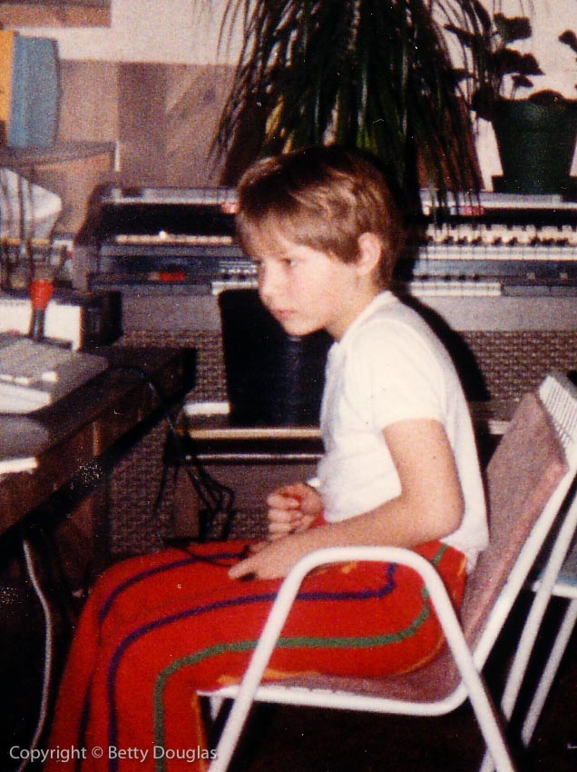
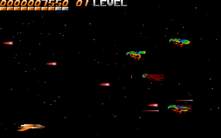
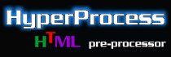

This is me. I work at [Jobber](http://getjobber.com/) as Lead Backend Developer. Jobber provides business management software for field service companies. Our web application is written in Ruby and runs on Rails 4. 

Besides a programmer and a pedestrian, my interests include writing, photography, board games, cooking and linguistics. I also organize the [Edmonton Go](http://edmontongo.org/) meetup and co-organize [YEGRB](http://yegrb.com/).

What follows is a brief history of becoming a programmer and what I'm excited for next.

## Childhood

I grew up on Lego, Dr. Seuss and Berenstain Bears in an Albertan village. After my parents divorced, an Atari Computer found its way into our home. As far as I knew, its sole purpose was to play video games.

Then one day the school library held a book fair where I found a colourful book filled with short BASIC programs (probably an Usborne).

My Dad saw my interest and bought me a coil-bound book to *really* learn BASIC. I got to use his [Kaypro](https://en.wikipedia.org/wiki/Kaypro) IV on the weekends. It came with BASIC and several games, including text adventures like *Colossal Cave* and *Hitchhiker's Guide to the Galaxy*.

My first computer was a Commodore 16 from a garage sale, tape drive and all! I wrote a historic text adventure where your character wandered Israel in search of Jesus. It wasn't necessarily sophisticated or well-researched, but one of my first computer projects.

## Teens

By junior high, our school upgraded the lab from Apple IIs to amber-screened XTs. Thankfully there was one computer with a colour screen, and our neighbours let me use their PC after school. Progressing from GW-BASIC to QBasic, I did remakes of Star Traders and Atlantis.

In addition to lawn-mowing income, I made money tutoring people on computers. When I had enough saved, I went to *Programmers Guild* to buy Turbo C 2.0. Unfortunately Turbo C wasn't the most approachable:

* A simple syntax error would dump a dozen seemingly unrelated errors.
* I found the IDE confusing, the keys reminded me of WordStar!

[QuickBASIC](https://en.wikipedia.org/wiki/Quickbasic) 4.5 turned out to be a much better investment.

While in Grade 9, my Mom helped me pay for a correspondence course from NRI (McGraw Hill). The three-year course covered computer programming in five languages and came with a 386 SX. That computer would see every component replaced over the course of several years.

Resolved in my future career path, I wrote a letter to 
Nintendo and received a genuine response encouraging me in my studies to become a programmer.

Inspired by Galaga and other SHMUPs, my brother and I set out to make **Firebirds**. It had timing issues on faster computers and the "scrolling" and collision system were amateurish. While not exactly [Raptor](https://en.wikipedia.org/wiki/Raptor:_Call_of_the_Shadows), it was a complete game, with title screens, difficulty levels, 2-players, sound effects, and both mouse and keyboard control. We distributed it through local Bulletin Board Systems (BBS). 

My high school needed an application to do timed typing tests, so I wrote one. The first version of **Trial Type** was a DOS application written in QuickBasic. I registered **Lynx Software** as a sole proprietorship and licensed the software to a number of schools.

QuickBasic also allowed me to build a custom database for an alarm installation company. I was proud of the text-based UI, but unfortunately I had never heard of B-trees. It got slow with more data.

Eventually I gave Turbo C another try, using DOS `edit` and the command-line compiler instead of that wretched IDE. Borland C++ allowed me to make a Windows version of Trial Type and the far less successful **Graphematics** (think graphing calculator).

Apps were making me money, but I still really wanted to make games. By now I was using C and Assembler and experimenting with Mode X, VESA and EMS/XMS memory. <mark>640K really wasn't enough.</mark> I bought [Watcom C/C++](https://en.wikipedia.org/wiki/Watcom_C) so I could use DOS4GW. It was wondrous!

The Internet turned out to be quite useful. I was able to assemble a team of artists to work on a real-time strategy game entitled **Galaxy**. We got a prototype up and running, but it was difficult to maintain the initial momentum. The rise of DirectX brought the question of whether to continue or switch technologies. In the end, the prototype was as far as we got.

## Career

At that time the web was still relatively new. I remember reading the HTML 2.0 specification, one of the few available resources to learn it. 

It wasn't long before I wrote a command-line tool to make HTML easier to work with. **HyperProcess** was a preprocessor for HTML. It supported file includes and other features, while also serving to lint and compress your HTML. Think static-site generator sans-Markdown.

I used HyperProcess at my first web development job. At my next job, I discovered Server Side Includes and eventually ColdFusion. By the turn of the century, the combination of SQL, ColdFusion, and JavaScript made for a platform where I could do "real programming." 

I stuck with ColdFusion for eight years across three jobs. Then *Ruby on Rails* came along, enticing me with its ORM and organized file layout. It didn't hurt that I have a certain fondness for trains (my Dad worked for CN Rail when I was young). Ruby has been my primary language for the past eight years (for a detailed breakdown, see my [resume](http://careers.stackoverflow.com/nathany)).

When I began this career, I didn't know the web would become this open platform for building apps, that the SaaS model would become a predominate way to distribute software. I fell into web development, and I'm really glad I did!

## Next

Let's talk about the next generation of developers, programming languages, and software.

As I reminisce of the people and authors who got me to where I am, I think about the next generation of web developers. While I've taken to <mark>writing what I learn</mark> and mentor occasionally, there is so much more to do.

After evaluating several languages and paradigms, I settled on [Go](http://golang.org/). The emphasis on [productivity](http://talks.golang.org/2012/splash.article), efficiency and simplicity appeals to me. My open source involvement has increased, I want to help grow the available libraries and the community. Organizing the [Edmonton Go](http://edmontongo.org/) meetup is my contribution to the latter.

I work at a startup. We deploy SaaS and deploy often. We have a simple sustainable model: monthly subscriptions. Despite all the activity in the native/mobile space, my focus remains on the web as a platform. <mark>"Embrace the document"</mark> resonates with me, while the Web Component future grabs for my attention.

For that extra push in working on a side-product, I joined [JFDI](http://jfdi.bz/). We'll see what comes of it.

